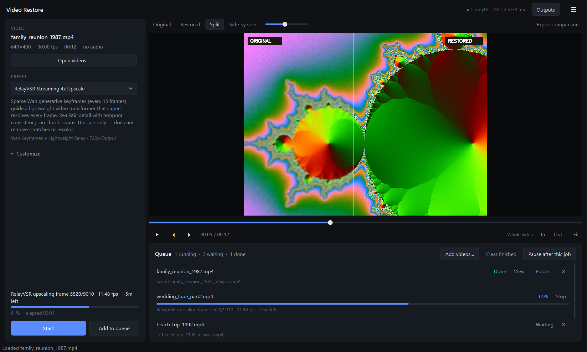

# Video Restore Studio

A local desktop app for upscaling and restoring old video on a single consumer GPU
(built and tuned on an RTX 5060 Ti 16 GB, Windows 11).

- **RelayVSR streaming 4x upscale** (default): sparse [Wan](https://github.com/kopperx/RelayVSR) generative
  keyframes guide a lightweight relay network that super-resolves every frame. ~11 fps for 640×480 → 720p
  on a 16 GB card; a 5-minute episode takes about 14 minutes. Runs without ComfyUI.
- **LTX-2.5 generative restoration** through ComfyUI: Restore and Refine-Details IC-LoRAs, tiled fusion
  up to 4K/8K, era presets (1920s B&W, Kodachrome, VHS…), defect detection and prompt synthesis.
- **Fast upscalers**: Real-ESRGAN x2 and 4x-UltraSharp.



## What it does well

- **Batch queue**: drop or pick many videos, choose one output folder, process them unattended.
- **Resumable jobs**: RelayVSR writes 10-second segments; stopping a job (or closing the app) keeps
  everything finished, saves a `_partial.mp4`, and **Resume** continues from the last segment.
- **Fits 16 GB cards**: the RelayVSR worker measures free VRAM at start and keeps just enough of Wan's
  transformer blocks in pinned system RAM, so nothing spills into the driver's slow shared memory.
- **Recovers from slowdowns**: per-segment speed is tracked against the best seen; if other apps take GPU
  memory and speed collapses, the worker restarts at a segment boundary (no frames lost) and resumes.
- **Exact sync**: constant-frame-rate preprocessing with the source's rational frame rate and
  sample-exact audio trimming, so output length and A/V sync match the source.
- **Compare**: Original / Restored / Split / Side-by-side in the player, plus exported comparison videos.

## Requirements

- Windows 10/11, NVIDIA GPU (16 GB recommended), recent driver, `ffmpeg`/`ffprobe` on `PATH`
- Python 3.10+ for running from source, and [uv](https://docs.astral.sh/uv/) for the RelayVSR environment
- ComfyUI (only for the LTX-2.5 and SoL engines), default `C:\ComfyUI_portable` —
  override with the `COMFYUI_ROOT` / `COMFYUI_DIR` environment variables

## Setup

```bash
git clone https://github.com/askitcommv-bit/video-restore-studio.git
cd video-restore-studio

# Desktop app dependencies
pip install -r requirements-app.txt

# RelayVSR: clones the upstream repo into third_party/, creates its own CUDA venv, downloads weights
python restore_cli.py download --relayvsr

# Optional: LTX-2.5 models for ComfyUI (~40 GB; gated on Hugging Face, set a token in the app's menu)
python restore_cli.py download
```

## Run

- **From source**: `python main.py` (or `run.bat`)
- **Executable**: download `VideoRestoreStudio-win64.zip` from the
  [Releases](https://github.com/askitcommv-bit/video-restore-studio/releases) page and extract it **into the
  cloned folder**, so `VideoRestoreStudio.exe` sits next to `workflows\` and `third_party\`. The exe uses
  its own folder as the project folder. Build it yourself with `build_exe.bat`.
  (The optional depth-map export needs the source install, since the exe doesn't bundle PyTorch.)
- **Command line**: `python restore_cli.py --help` (`restore`, `preprocess`, `compare`, `status`, `download`)
- **Browser UI**: `python web_ui.py` → http://localhost:7860

### Using the app

1. **Open videos…** (or drop files on the window). Several files are queued together after you pick an
   output folder.
2. Pick a **preset**. RelayVSR is the default; **Customize** reveals the engine, output size, fixes,
   reference portrait and prompt options that apply to the chosen engine.
3. Optionally mark a range in the player with **I** / **O** (**X** clears; Space plays, ← → step frames).
4. **Start** (asks where to save) or **Add to queue**, then **Start queue**.

## Project layout

```
main.py                 desktop app entry point
app/ui/                 PySide6 UI (sidebar, player, queue, theme)
app/core/               queue manager (persistent, resumable)
restore_engine.py       pipeline orchestration: preprocessing, engines, muxing, comparisons
relayvsr_worker.py      out-of-process RelayVSR CUDA worker (resident, segment output, VRAM fitting)
video_preprocessor.py   ffprobe/ffmpeg: CFR canvas, deinterlace, trims, audio, defect detection
comparison_generator.py side-by-side and split comparison renders
model_downloader.py     model/LoRA/RelayVSR installers and health checks
restore_cli.py          command-line interface
web_ui.py               browser dashboard
workflows/              ComfyUI workflow templates
docs/                   prompt guide, VRAM/performance notes
build_exe.bat           PyInstaller build of the desktop app
```

## LTX-2.5 model reference

| Component | File (16 GB VRAM) | Hugging Face repo |
|---|---|---|
| Distilled transformer | `ltx-2.5-22b-distilled-transformer-comfy-int8-convrot.safetensors` | `Lightricks/LTX-2.5` |
| Text encoder | `gemma4-12b-with-proj-ltx-2.5-comfy-int8-convrot.safetensors` | `Lightricks/LTX-2.5` |
| Video VAE | `ltx-2.5-video-vae-bf16.safetensors` | `Lightricks/LTX-2.5` |
| Audio VAE | `ltx-2.5-audio-vae-bf16.safetensors` | `Lightricks/LTX-2.5` |
| Restore IC-LoRA | `ltx-2.5-22b-ic-lora-restore-1.0.safetensors` | `Lightricks/LTX-2.5-22b-IC-LoRA-Restore` |
| Refine-Details IC-LoRA | `ltx-2.5-22b-ic-lora-refine-details-1.0.safetensors` | `Lightricks/LTX-2.5-22b-IC-LoRA-Refine-Details` |
| Spatial upscaler | `ltx-2.5-latent-spatial-upscaler-x2-bf16-1.0.safetensors` | `Lightricks/LTX-2.5` |

RelayVSR weights come from [`kopper/RelayVSR`](https://huggingface.co/kopper/RelayVSR) and its code from
[kopperx/RelayVSR](https://github.com/kopperx/RelayVSR); both keep their own licenses.
