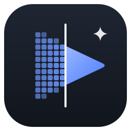
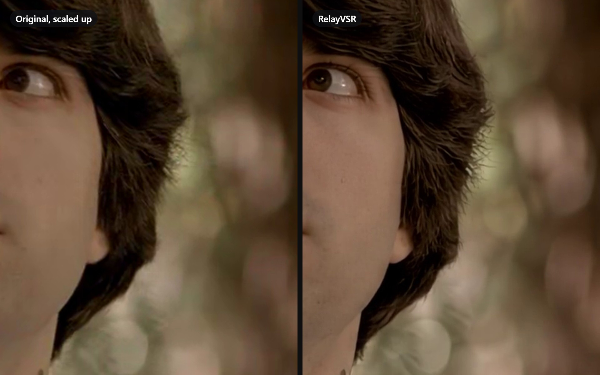
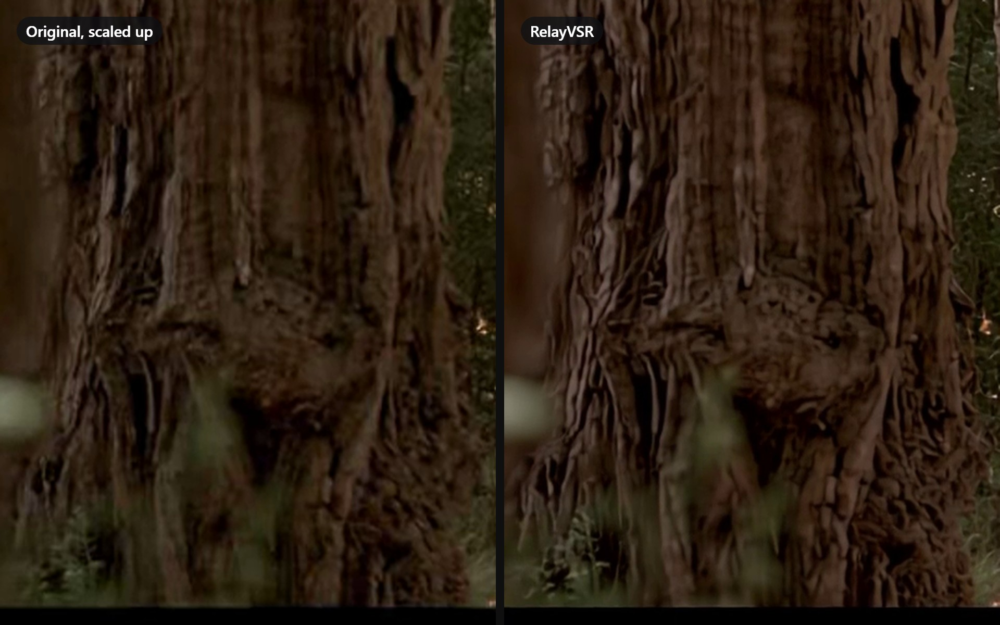
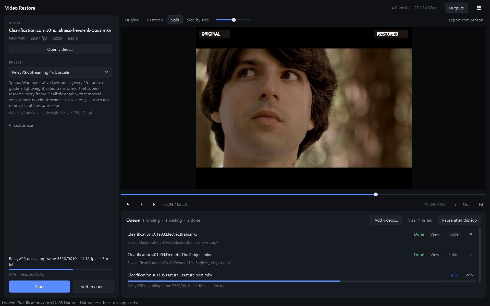

# Video Restore Studio

A local desktop app for upscaling and restoring old video on a single consumer GPU
(built and tuned on an RTX 5060 Ti 16 GB, Windows 11).

- **RelayVSR streaming 4x upscale** (default): sparse [Wan](https://github.com/kopperx/RelayVSR) generative
  keyframes guide a lightweight relay network that super-resolves every frame. ~11 fps for 640×480 → 720p
  on a 16 GB card; a 5-minute episode takes about 14 minutes. Runs without ComfyUI.
- **LTX-2.5 generative restoration** through ComfyUI: Restore and Refine-Details IC-LoRAs, tiled fusion
  up to 4K/8K, era presets (1920s B&W, Kodachrome, VHS…), defect detection and prompt synthesis.
- **Fast upscalers**: Real-ESRGAN x2 and 4x-UltraSharp.



*A 640×480 TV episode upscaled to 720p. Left: the original scaled up the usual way. Right: RelayVSR. Same frame, same crop.*





RelayVSR generates plausible detail. That works very well for faces, hair, foliage and texture; tiny text it
can't read may come out as letter-like shapes, so check scenes where small writing matters.

## What it does well

- **Batch queue**: drop or pick many videos, choose one output folder, process them unattended.
- **Resumable jobs**: RelayVSR writes 10-second segments; stopping a job (or closing the app) keeps
  everything finished, saves a `_partial.mp4`, and **Resume** continues from the last segment.
- **Fits 16 GB cards**: the RelayVSR worker measures free VRAM at start and keeps just enough of Wan's
  transformer blocks in pinned system RAM, so nothing spills into the driver's slow shared memory.
- **Recovers from slowdowns**: per-segment speed is tracked against the best seen; if other apps take GPU
  memory and speed collapses, the worker restarts at a segment boundary (no frames lost) and resumes.
- **Exact sync**: constant-frame-rate preprocessing with the source's rational frame rate and
  sample-exact audio trimming, so output length and A/V sync match the source.
- **Compare**: Original / Restored / Split / Side-by-side in the player, plus exported comparison videos.
- **Smaller files, automatically**: the final video is HEVC (about half the size of H.264, no visible
  difference) with AAC audio. The app test-encodes with NVIDIA NVENC, Intel Quick Sync, AMD AMF and x265
  and uses the first that works on the machine, or keeps H.264 if none does. H.264 can be chosen under
  Customize for very old players.

## Requirements

- Windows 10/11, NVIDIA GPU (16 GB recommended) with a recent driver
- About 20 GB of free disk space for the RelayVSR engine and models
- FFmpeg, Python and uv are downloaded by the setup when missing; Python 3.10+ only to run from source
- ComfyUI (only for the LTX-2.5 and SoL engines), default `C:\ComfyUI_portable` —
  override with the `COMFYUI_ROOT` / `COMFYUI_DIR` environment variables

## Setup

```bash
git clone https://github.com/askitcommv-bit/video-restore-studio.git
cd video-restore-studio

# Desktop app dependencies
pip install -r requirements-app.txt

# RelayVSR: same downloads as the app's setup (FFmpeg if missing, the RelayVSR code at a tested
# commit, its own Python 3.13 + CUDA environment, and the ~10 GB of weights). Needs neither git nor uv.
python restore_cli.py download --relayvsr

# Optional, for the ComfyUI engines (also under ☰ → Set up downloads… in the app):
# LTX-2.5 models (~40 GB; gated on Hugging Face: accept the license, then save a Read token)
python restore_cli.py token hf_xxx
python restore_cli.py download
# NVIDIA SoL-Refiner models (~23 GB)
python restore_cli.py download --sol
```

## Run

- **From source**: `python main.py` (or `run.bat`)
- **Executable**: download `VideoRestoreStudio-<version>.exe` (a single file) from the
  [Releases](https://github.com/askitcommv-bit/video-restore-studio/releases) page and run it from
  anywhere. On first start it offers to download what's missing (FFmpeg, the RelayVSR engine and models,
  about 14 GB once) into `%LOCALAPPDATA%\VideoRestoreStudio`, which is also where it keeps settings and
  the queue; **☰ → Set up downloads…** reopens it. Inside a clone (or a subfolder such as `dist\`) the exe
  uses the clone instead. It unpacks itself on each start, so the window takes about 3 seconds to appear.
  Build it yourself with `build_exe.bat`.
  (The optional depth-map export needs the source install, since the exe doesn't bundle PyTorch.)
- **Command line**: `python restore_cli.py --help` (`restore`, `preprocess`, `compare`, `status`, `download`)
- **Browser UI**: `python web_ui.py` → http://localhost:7860

### Using the app

1. **Open videos…** (or drop files on the window). Several files are queued together after you pick an
   output folder.
2. Pick a **preset**. RelayVSR is the default; **Customize** reveals the engine, output size, fixes,
   reference portrait and prompt options that apply to the chosen engine.
3. Optionally mark a range in the player with **I** / **O** (**X** clears; Space plays, ← → step frames).
4. **Start** (asks where to save) or **Add to queue**, then **Start queue**.

## Project layout

```
Entry points
  main.py                 desktop app (also VideoRestoreStudio.exe)
  restore_cli.py          command line: restore, batch, status, download, token, compare
  web_ui.py               browser dashboard
  bootstrap.py            start-up shared by all three (folders, PATH for downloaded tools)

Engine (engine/)
  request.py              RestoreRequest: one job's settings, built by every front end
  pipeline.py             orchestration: output file, chunking, preparing, hand-off to an engine
  relayvsr.py             RelayVSR: resident worker, resumable segments, slowdown recovery
  comfy/graphs.py         ComfyUI prompt graphs (super-resolution, SoL-Refiner, LTX-2.5)
  comfy/client.py         ComfyUI REST/WebSocket client
  comfy/job.py            one ComfyUI-engine job: graph, run, result
  chunked.py              long ranges on ComfyUI engines: chunk, render, cross-fade, join
  output.py               final delivery: audio, HEVC encode, comparisons
  requirements.py         what each engine needs installed
relayvsr_worker.py        the RelayVSR CUDA worker, run in RelayVSR's own Python environment

Setup and models
  setup_manager.py        in-app setup: FFmpeg, RelayVSR engine and models, optional ComfyUI packs
  comfy_models.py         the ComfyUI engines' model files, status, downloads, Hugging Face token
  downloads.py            resumable downloads with progress and cancellation
  relayvsr_requirements.txt  pinned packages of the tested RelayVSR environment

Shared
  config.py               folders, model file names, repositories, constants (no side effects)
  presets.py              restoration presets, defect ticks -> LTX pipeline
  user_settings.py        settings saved in config.json
  outputs.py              output file naming
  errors.py               typed errors and their one-line explanations
  processes.py            starting helper programs without console windows
  gpu.py                  NVIDIA GPU name and free memory
  video_preprocessor.py   ffprobe/ffmpeg: CFR canvas, deinterlace, trims, audio, defect detection
  video_encoders.py       picks the best HEVC encoder the PC has
  comparison_generator.py side-by-side and split comparison renders

Desktop app (app/)
  core/                   queue, video loader, job submission checks, system status (no widgets)
  ui/                     main window, header, sidebar, player, queue, setup dialog, theme

dev/                      debugging scripts against a running ComfyUI, and the original ComfyUI
                          workflow templates (the app builds its graphs in code; not needed to run it)
docs/                     prompt guide, VRAM/performance notes
build_exe.bat             PyInstaller build of the desktop app
```

## LTX-2.5 model reference

| Component | File (16 GB VRAM) | Hugging Face repo |
|---|---|---|
| Distilled transformer | `ltx-2.5-22b-distilled-transformer-comfy-int8-convrot.safetensors` | `Lightricks/LTX-2.5` |
| Text encoder | `gemma4-12b-with-proj-ltx-2.5-comfy-int8-convrot.safetensors` | `Lightricks/LTX-2.5` |
| Video VAE | `ltx-2.5-video-vae-bf16.safetensors` | `Lightricks/LTX-2.5` |
| Audio VAE | `ltx-2.5-audio-vae-bf16.safetensors` | `Lightricks/LTX-2.5` |
| Restore IC-LoRA | `ltx-2.5-22b-ic-lora-restore-1.0.safetensors` | `Lightricks/LTX-2.5-22b-IC-LoRA-Restore` |
| Refine-Details IC-LoRA | `ltx-2.5-22b-ic-lora-refine-details-1.0.safetensors` | `Lightricks/LTX-2.5-22b-IC-LoRA-Refine-Details` |
| Spatial upscaler | `ltx-2.5-latent-spatial-upscaler-x2-bf16-1.0.safetensors` | `Lightricks/LTX-2.5` |

RelayVSR weights come from [`kopper/RelayVSR`](https://huggingface.co/kopper/RelayVSR) and its code from
[kopperx/RelayVSR](https://github.com/kopperx/RelayVSR); both keep their own licenses.
